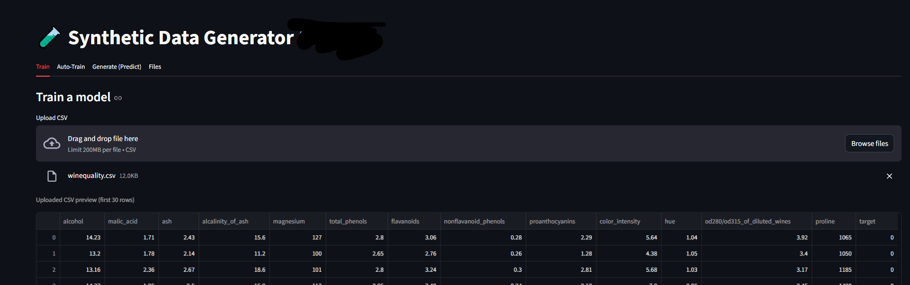
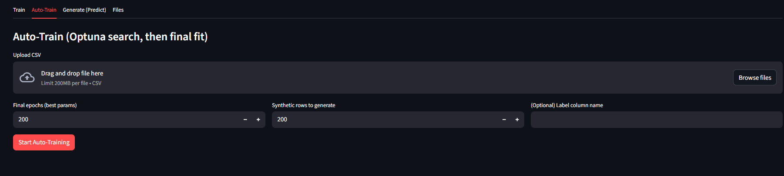
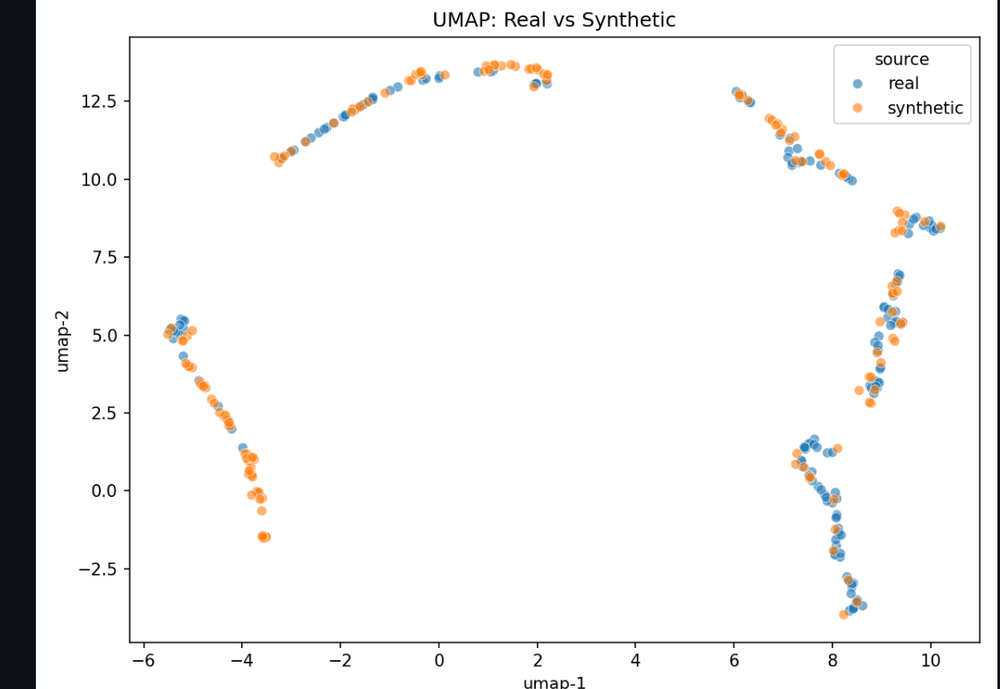
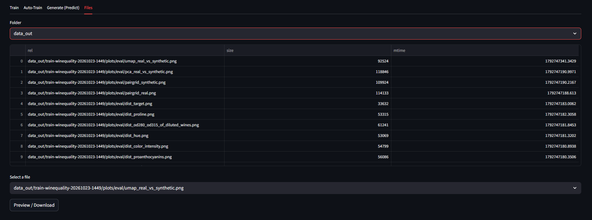

# Synthetic Tabular Data Generator

A machine-learning engineering project for generating synthetic tabular data through a configurable training workflow, with a web interface, API layer, automated hyperparameter search, and data-quality exploration.

> **Project status:** The screenshots document a local application run and its observed interface. Review the implementation and validate generated data before using it operationally.

## Screenshots

### Training interface

Upload a CSV, configure training epochs and the number of synthetic rows, and optionally provide a label-column name.

### Automated training

The automated workflow searches model configurations and then performs a final fit using the selected settings.

### Real versus synthetic visualization

This two-dimensional projection provides an exploratory visual comparison between real and generated records. Visual overlap alone does not establish statistical equivalence, downstream utility, or privacy.

### Generated artifact browser

The Files tab lists output artifacts such as evaluation plots and lets users select files for preview or download.

## Intended workflow

1. Upload a tabular CSV dataset.
2. Configure the training options.
3. Train a generative model or use automated hyperparameter search.
4. Generate synthetic records.
5. Inspect evaluation metrics and visualizations.
6. Download generated data and artifacts.

## Technology stack

- Python
- pandas and NumPy
- scikit-learn
- Streamlit
- FastAPI
- Optuna for hyperparameter search

## Evaluation considerations

Before relying on generated data, assess:

- Column distributions and category frequencies
- Pairwise relationships and correlations
- Schema, data types, valid ranges, and constraints
- Downstream machine-learning utility using a held-out real test set
- Privacy risks, including potential memorization of rare records

Synthetic data is not automatically anonymous, unbiased, or equivalent to real data.

## Repository scope

This public repository showcases the application workflow, interface, documentation, and selected visual examples. Proprietary implementation details are intentionally not documented here.

## Limitations

The screenshots illustrate observed behavior, not a guarantee that every workflow is production-ready. Validate the installation, API integration, output schema, and evaluation methodology before operational use.
